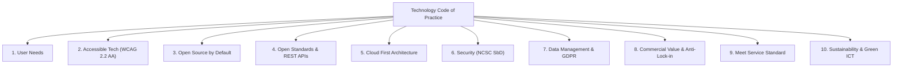

> **Author**: andylockran  
> **License**: Apache-2.0 (Attribution Required)

# UK Government Digital Standards (`govuk-digital-standards`)

The **UK Government Digital Standards** framework represents the unified standard for building, operating, and assessing public sector digital services across central government departments, executive agencies, and arms-length bodies (ALBs).

Any digital service handling citizen or staff interactions in the UK public sector must satisfy the three mandatory governance pillars:

```text
       ┌─────────────────────────────────────────────────────────────┐
       │                   UK PUBLIC SECTOR TRIAD                    │
       ├──────────────────────────────┬──────────────────────────────┤
       │ 1. GDS Service Standard      │ 14 service delivery & user   │
       │    (Central Digital & Data)  │ experience points.           │
       ├──────────────────────────────┼──────────────────────────────┤
       │ 2. Technology Code of        │ 10 technology evaluation and │
       │    Practice (TCoP)           │ procurement criteria.        │
       ├──────────────────────────────┼──────────────────────────────┤
       │ 3. NCSC Secure by Design     │ 8 continuous cybersecurity   │
       │    (SbD Framework)           │ & risk management principles.│
       └──────────────────────────────┴──────────────────────────────┘
```

---

## 🧭 Service Lifecycle Phases

UK government delivery progresses through five distinct agile lifecycle phases. Each phase requires specific evidence before proceeding past formal assessment gates:

| Phase | Core Objective | Key Gate Evidence Needed |
| :--- | :--- | :--- |
| **Discovery** | Understand the problem space and user needs. | User research synthesis, problem definition, non-digital channels, "Do not build" option evaluated. |
| **Alpha** | Test multiple risky technical and design hypotheses. | Working prototypes, tested tech architecture, discarded options documented, initial threat model. |
| **Beta (Private)** | Build the end-to-end service with real users in volume. | Production infrastructure, full WCAG 2.2 AA audit, One Login integration, DPIA, operational runbooks. |
| **Beta (Public)** | Open service to all eligible users; iterate rapidly. | Public performance dashboard live, GOV.UK banner integration, continuous deployment pipelines. |
| **Live** | Continuous operational excellence and improvement. | 4 core KPIs actively tracked, disaster recovery tested, ongoing security pen testing, service retirement plan. |

---

## 🏛️ Pillar 1: GDS Service Standard (14 Points)

All agents working on public sector codebases must design and implement against these 14 standard points:

### 1. Understand Users and Their Needs
- Base every feature, user story, and API endpoint on documented, empirical user research.
- Include users with low digital confidence and assistive technology needs in research cohorts.
- Never make assumptions on behalf of users; provide traceability from user need to code.

### 2. Solve a Whole Problem for Users
- Integrate the digital service with end-to-end offline touchpoints (paper, call centres, face-to-face).
- Bridge departmental boundaries where user tasks span multiple agencies (e.g. cross-government life events).

### 3. Provide a Joined-Up Experience Across Channels
- Ensure consistent state, terminology, and verification across phone, web, and paper.
- Allow users to save progress, resume later, and switch between channels without data re-entry.

### 4. Make the Service Simple to Use
- **Content Design**: Use plain English (reading age 9–11), active voice, and clear action-oriented microcopy.
- **GOV.UK Design System**: Strictly use `govuk-frontend` (or official wrappers like `govuk-react`) for UI elements.
- Adhere to canonical GOV.UK patterns: Task Lists, Check Answers pages, Question Pages (one thing per page), and Error Summaries.

### 5. Make Sure Everyone Can Use the Service (Accessibility)
- **Legal Mandate**: Satisfy the *Public Sector Bodies (Websites and Mobile Applications) Accessibility Regulations 2018*.
- **Standard**: Achieve full compliance with **WCAG 2.2 Level AA**.
- **Automated Gates**: Run automated accessibility tests (`axe-core`, `pa11y`, `eslint-plugin-jsx-a11y`) in CI.
- **Assistive Tech**: Guarantee seamless navigation via screen readers (NVDA, JAWS, VoiceOver), keyboard only, high contrast, and speech input.
- **Accessibility Statement**: Publish an up-to-date accessibility statement following the GOV.UK sample template.

### 6. Have an Agile, Multidisciplinary Team
- Ensure clear separation of concerns across Product Owner, Technical Architect, Delivery Manager, Service Designer, Content Designer, User Researcher, Software Engineers, and QA.

### 7. Use Agile Ways of Working
- Work in iterative sprint cycles with daily standups, backlog refinement, sprint reviews, and retrospectives.
- Commit small, deployable diffs continuously rather than large waterfall batches.

### 8. Iterate and Improve Frequently
- Deploy frequently with automated zero-downtime releases.
- Actively gather user feedback via in-service feedback loops and qualitative research.

### 9. Create a Secure Service Which Protects Users' Privacy
- Comply strictly with UK GDPR and the Data Protection Act 2018.
- Conduct and maintain a **Data Protection Impact Assessment (DPIA)**.
- Practice data minimization: collect only the absolute minimum data required to deliver the transaction; hash or discard PII promptly.
- Direct alignment with **NCSC Secure by Design** (see Pillar 3).

### 10. Define Success and Publish Performance Data
Track and publish the **4 Mandatory Government KPIs**:
1. **Cost per transaction** (operational cost divided by volume of completed transactions).
2. **User satisfaction** (% of users rating the service easy or very easy).
3. **Completion rate** (% of started journeys that reach the confirmation page).
4. **Digital take-up** (% of total transactions completed digitally vs offline).

### 11. Choose the Right Tools and Technology
- Select modern, sustainable, well-supported technologies that comply with the Technology Code of Practice (see Pillar 2).

### 12. Make New Source Code Open
- **Default to Open**: Make all new source code publicly available under an approved open-source license (e.g. MIT, Apache-2.0, Open Government Licence v3).
- **Coding in the Open**: Develop in public GitHub/GitLab repositories from Day 1 unless an explicit national security or fraud prevention exemption applies.
- **Zero Leak Discipline**: Never commit secrets, credentials, internal IP addresses, or unredacted test data to the public repo.

### 13. Use Open Standards and Common Platforms
Adopt central government common platforms before building custom solutions:
- **GOV.UK One Login**: Citizen authentication and identity verification.
- **GOV.UK Notify**: Transactional emails, text messages (SMS), and postal letters.
- **GOV.UK Pay**: Credit card and direct debit payment processing.
- **Open Standards**: Adhere to Central Digital and Data Office (CDDO) open data schemas, RFC 7807 problem details, and OpenAPI 3.0+.

### 14. Operate a Reliable Service
- Establish explicit Service Level Objectives (SLOs) and Service Level Agreements (SLAs).
- Architect for high availability across multi-AZ public cloud regions with automated failover.
- Maintain tested incident response runbooks and recovery time/point objectives (RTO/RPO).

---

## ⚙️ Pillar 2: Technology Code of Practice (TCoP)

The 10 TCoP criteria govern technical architecture, cloud procurement, and software development:



### Key Technical Mandates:
1. **Cloud First (Criterion 5)**:
   - Deploy exclusively to public hyperscale clouds (AWS, Azure, GCP).
   - Prefer managed platform services (PaaS), serverless functions, or managed Kubernetes over unmanaged IaaS VMs.
   - Enforce Infrastructure as Code (IaC) via Terraform, OpenTofu, or Pulumi.
2. **Open Standards & APIs (Criterion 4)**:
   - Design public APIs using the Central Digital and Data Office API technical standards.
   - Use standard REST over JSON with OpenAPI 3.0+ specifications.
   - Standardize error formatting using RFC 7807 (`application/problem+json`).
   - Use ISO 8601 UTC timestamps (`YYYY-MM-DDTHH:MM:SSZ`) and standard UUIDv4 identifiers.
3. **Disaggregation & Anti-Lock-in (Criterion 8)**:
   - Break monolithic architectures into modular, independently deployable services.
   - Prevent vendor lock-in by using standardized protocols, portable container runtimes (OCI), and vendor-neutral interfaces.
4. **Sustainability (Criterion 10)**:
   - Adhere to the *Greening Government: ICT and Digital Services Strategy*.
   - Scale down dev/test environments outside working hours; optimize compute sizing and memory usage.

---

## 🛡️ Pillar 3: NCSC Secure by Design (SbD)

The National Cyber Security Centre (NCSC) Secure by Design framework replaces retrospective security audits with continuous, proactive cybersecurity engineering:

### 1. Understand the Security Context & Threat Landscape
- Maintain an active **STRIDE** (Spoofing, Tampering, Repudiation, Information Disclosure, Denial of Service, Elevation of Privilege) threat model.
- Maintain a **LINDDUN** privacy threat model for PII flows.
- Map the complete attack surface (public ingress points, API gateways, external integrations, third-party CDNs).

### 2. Make Security a Continuous Lifecycle Activity
- Security requirements must be written as acceptance criteria in user stories from sprint planning.
- Run threat modeling sessions at every major architectural shift, not just at project completion.

### 3. Minimize Attack Surface
- **Principle of Least Privilege**: IAM roles must declare granular resource ARNs with minimal action sets (`actions: ["s3:GetObject"]`, never `s3:*`).
- Disable all unused ports, debug routes, Swagger UI endpoints in production, and administrative backdoors.
- Use minimal, hardened container base images (e.g. Google Distroless or Alpine).

### 4. Layered Defense (Defense in Depth)
- Assume breach: never trust internal networks or perimeter firewalls alone.
- Place a Web Application Firewall (AWS WAF / Cloudflare) in front of public ingress with OWASP Core Rule Sets.
- Enforce mandatory HTTP security headers:
  ```http
  Content-Security-Policy: default-src 'self'; script-src 'self'; object-src 'none'; frame-ancestors 'none';
  Strict-Transport-Security: max-age=63072000; includeSubDomains; preload
  X-Content-Type-Options: nosniff
  X-Frame-Options: DENY
  Referrer-Policy: strict-origin-when-cross-origin
  Permissions-Policy: geolocation=(), camera=(), microphone=()
  ```

### 5. Cryptographic Protection of Data
- **In Transit**: Enforce TLS 1.3 (or TLS 1.2 with PFS cipher suites). Disable SSLv3, TLS 1.0, and TLS 1.1.
- **At Rest**: AES-256-GCM encryption for all database volumes, S3 buckets, queues, and backups managed by cloud KMS.
- **Secret Management**: Zero secrets in source code, environment templates, or Dockerfiles. Store credentials in AWS Secrets Manager, HashiCorp Vault, or macOS Keychain.

### 6. Identity, Authentication & Session Security
- Rely on modern federated protocols (OIDC, SAML 2.0, OAuth 2.0 with PKCE).
- Integrate **GOV.UK One Login** for citizen identity; enforce hardware/app-based MFA for staff and administrative portals.
- Issue short-lived JWTs (15–60 min) with refresh token rotation; store tokens in secure, HttpOnly, SameSite=Strict cookies.

### 7. Continuous Automated Security Assurance in CI/CD
Incorporate automated quality gates into GitHub Actions / GitLab CI:
```yaml
# Recommended CI security matrix
- name: Secret Scanning (Gitleaks / Trufflehog)
- name: Static Application Security Testing (CodeQL / Semgrep)
- name: Software Bill of Materials (Syft / CycloneDX)
- name: Dependency Scanning & Vulnerability Check (Trivy / Snyk)
- name: Container Image Hardening Scan (Trivy fs / docker scan)
- name: Automated Accessibility Scan (pa11y-ci / axe-core)
```

### 8. Resilience, Observability & Incident Response
- Centralized immutable logging (AWS CloudWatch Logs with KMS encryption, Splunk).
- Ensure logs record user actions for auditability while strictly redacting PII, session tokens, passwords, and card numbers.
- Maintain automated health checks, synthetic monitoring, and pager alerts for error rates exceeding SLO thresholds.

---

## 📋 GDS Service Assessment Review Rubric

When preparing for an Alpha, Beta, or Live GDS assessment, evaluate the project against this checklist:

| Category | Assessment Question | Target Evidence | Status |
| :--- | :--- | :--- | :---: |
| **Users** | Has the service been tested with at least 5 users with access needs? | User research session recordings, synthesis boards, accessibility lab notes. | [ ] |
| **Design** | Does the interface follow GOV.UK Design System patterns and styles? | Screenshots of Question Pages, Error Summaries, Task Lists using `govuk-frontend`. | [ ] |
| **Accessibility** | Does the site achieve WCAG 2.2 AA compliance across all components? | External DAC / Shaw Trust accessibility audit report + automated axe-core CI logs. | [ ] |
| **Openness** | Is source code published publicly with an open license? | Public GitHub URL, LICENSE (MIT/Apache), zero sensitive data committed. | [ ] |
| **Architecture** | Does the architecture adhere to Cloud First and use Open Standards? | Infrastructure as Code (Terraform), OpenAPI specification, architecture diagram. | [ ] |
| **Security** | Has threat modeling and penetration testing been conducted? | STRIDE threat model, CHECK-certified pen test report, remediation tracking. | [ ] |
| **Platforms** | Has the team evaluated or integrated GOV.UK common platforms? | Evidence of GOV.UK One Login, Notify, or Pay integration (or justification if not). | [ ] |
| **Operations** | Are the 4 mandatory KPIs tracked, and is an on-call rota active? | Grafana/CloudWatch dashboards, PagerDuty rota, incident response runbooks. | [ ] |

---

## 🛠️ Automated Validation Tool

This skill bundles an automated repository scanner to check for compliance markers:

```bash
# Run audit against current repository
python3 skills/govuk-digital-standards/scripts/audit-govuk-standards.py

# Run audit against specific project with JSON output
python3 skills/govuk-digital-standards/scripts/audit-govuk-standards.py --target /path/to/govuk-app --format json
```
